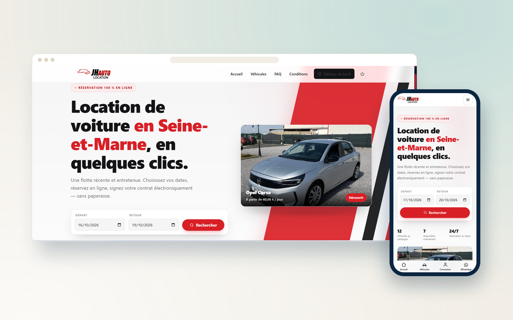
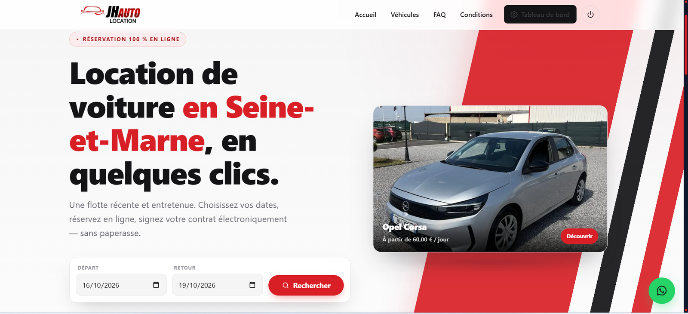
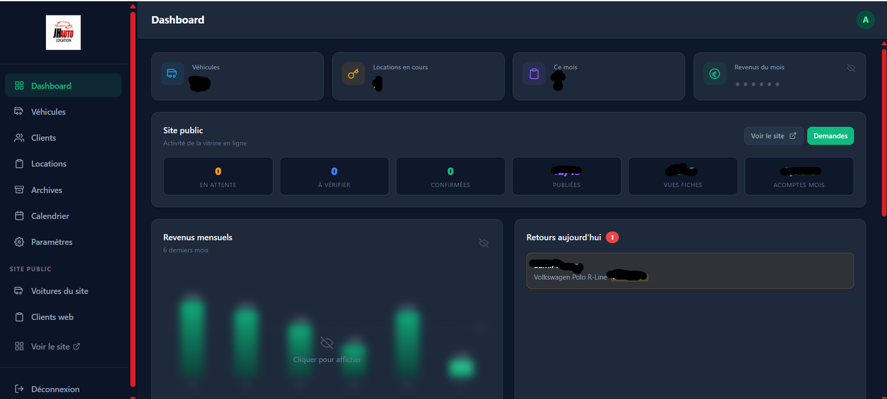
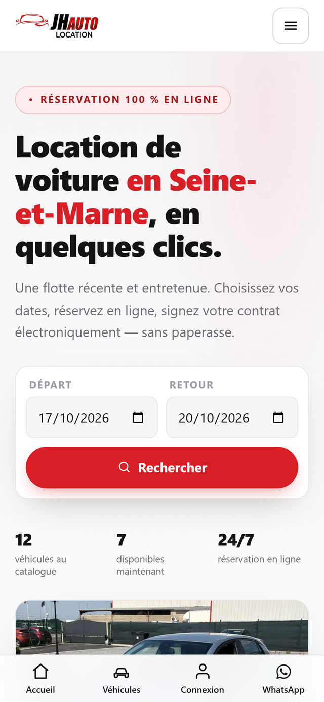

  

<h1 align="center">JH AUTO LOCATION</h1>

  <b>Plateforme de location de voitures avec calendrier de réservations, contrats PDF et emails automatiques.</b>
   
  Car rental platform with a booking calendar, PDF contracts and automated emails.

  
  

  
  
  
  
  
  

---

## Le projet

Une plateforme complète de gestion de location de véhicules, pensée pour remplacer le suivi papier et les tableurs. L'agence visualise l'ensemble de son parc sur un calendrier partagé, génère les contrats de location en PDF en un clic et déclenche automatiquement les emails de confirmation et de rappel envoyés aux clients.

## Fonctionnalités

- Calendrier de réservations multi-véhicules, avec détection des conflits de dates
- Génération de contrats de location en PDF, pré-remplis avec les données du client
- Emails transactionnels automatiques : confirmation, rappel de départ, retour de véhicule
- Back-office complet : parc de véhicules, tarifs, clients et historique des locations
- Authentification sécurisée et rôles séparés pour les agents

## Aperçu

### Ordinateur

  

### Mobile

  

## Fiche

| | |
|---|---|
| **Type** | Système sur mesure |
| **Contexte** | Projet client · France |
| **Année** | 2025 |
| **Rôle** | Conception et développement complets (design, front-end, back-end, mise en ligne) |
| **Technologies** | React · Vite · Supabase · FullCalendar · jsPDF · Resend |
| **Site** | [jhauto.fr](https://jhauto.fr) |

## Code source

> [!NOTE]
> Le code source de ce projet client est privé. Ce dépôt est une vitrine : il présente le projet, ses fonctionnalités et des captures.
> Pour en discuter ou pour un projet similaire : [portfolio](https://satouri-dev.vercel.app/fr) · [LinkedIn](https://www.linkedin.com/in/abdel-monaam-satouri-054268314).

---

  Conçu et développé par <a href="https://satouri-dev.vercel.app/fr">Satouri Développement</a> · Djerba, Tunisie
   
  © 2025 Abdelmonaam Satouri — Tous droits réservés

